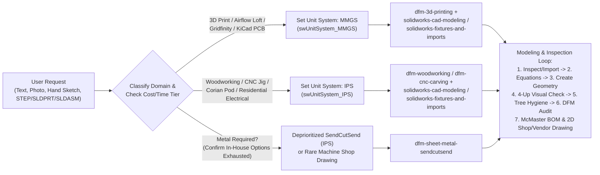

# SOLIDWORKS MCP Architecture, Workflow Routing & Tool Map

This reference document maps the end-to-end routing between user requests, Antigravity rules/skills, domain catalogs (`shop_profile.json` & `sendcutsend_catalog.json`), the ~43 structured MCP tools + `sw_execute_csharp`, and the underlying SOLIDWORKS 2026 COM API.

---

## 1. Prompt-to-Unit, Skill & Tool Routing Map

---

## 2. Complete MCP Tool Inventory (`43 Structured Tools` + `sw_execute_csharp`)

> **API Unit Rule**: The SOLIDWORKS COM API always expects lengths in **meters** and angles in **radians** regardless of the document's display unit system (`MMGS` or `IPS`). Every structured tool accepts explicit `"units": "mm" | "in" | "m"` (defaulting to the active document's unit system, or domain default `MMGS`/`IPS` on creation) and performs exact conversion internally (`1 in = 0.0254 m`, `1 mm = 0.001 m`).

### A. Session, Document & Catalog Tools (`DocumentAndSessionTools.cs`)
| Tool Name | Key Parameters | SOLIDWORKS COM APIs | Return Payload |
| :--- | :--- | :--- | :--- |
| `sw_connect_status` | `launch_if_closed` | `Marshal.GetActiveObject("SldWorks.Application")`, `Activator.CreateInstance` | Active SOLIDWORKS version, open docs list, active doc path/type/units |
| `sw_open_or_import_document` | `file_path`, `unit_override`, `heal_import` | `OpenDoc6`, `LoadFile4`, `SetUserPreferenceIntegerValue(swUnitSystem)` | Document handle info, body count, initial bounding box, import diagnostics |
| `sw_create_document` | `doc_type` (`part`/`assembly`/`drawing`), `domain` (`3d_printing`/`gridfinity`/`electronics_kicad`/`woodworking`/`cnc`/`sendcutsend`), `save_path`, `template_path` | `NewDocument`, `Extension.SetUserPreferenceIntegerValue(swUnitSystem_MMGS \| swUnitSystem_IPS)` | Created doc name, enforced unit system (`MMGS` or `IPS`), template used |
| `sw_save_document` | `save_path`, `save_all_components` | `Save3`, `SaveAs3` | Saved paths and dirty-state status |
| `sw_export_document` | `format` (`step`/`stl`/`3mf`/`dxf`/`dwg`/`pdf`), `output_path`, `stl_deviation_mm`, `stl_angle_deg`, `body_names` | `Extension.SaveAs`, `IPartDoc.ExportToDWG2` | Exported file path(s), mesh triangle count / export warnings |
| `sw_get_shop_profile` | `section` (`all`/`hierarchy`/`printing_3d`/`gridfinity`/`electronics`/`airflow`/`cnc`/`woodworking`/`sendcutsend`), `material`, `thickness_in` | Reads embedded `shop_profile.json` & `sendcutsend_catalog.json` | Full structured specs, bit library, insert specs, SendCutSend bend/K-factor lookup |

### B. B-Rep Topology, Datum & Clearance Inspection (`TopologyDatumExtractor.cs`)
| Tool Name | Key Parameters | SOLIDWORKS COM APIs | Return Payload |
| :--- | :--- | :--- | :--- |
| `sw_inspect_model_summary` | `target_doc`, `units` | `IGetBodies2`, `IMassProperty`, `IBody2.GetBodyBox` | Body list, tight 3D bounding box, mass, volume, CoG, active units, feature count |
| `sw_inspect_feature_tree` | `target_doc`, `include_subfeatures` | `IFeatureManager.GetFeatures`, `GetParents`, `GetChildren`, `GetErrorCode2` | Hierarchical feature tree JSON, sketch constrained states (`(-)`/`(+)`/`resolved`), rebuild errors |
| `sw_inspect_topology_datums` | `target_doc`, `body_name`, `extract_hole_patterns`, `extract_planar_datums`, `pcb_mode` | `IBody2.GetFaces`, `IFace2.GetSurface`, `ISurface.IsPlane`, `IsCylinder`, `GetLoops`, `GetEdges` | Ranked planar mounting faces (normals, areas, bounds, deterministic token IDs), coaxial holes/counterbores/bosses, coplanar bolt-hole patterns (PCD, grid spacing), and KiCad PCB board/connector keep-outs when `pcb_mode=true` |
| `sw_measure_clearance` | `component_or_body_a`, `component_or_body_b` | `IModelDocExtension.CheckInterference3`, `ICollisionDetectionManager`, `GetMinimumDistanceBetweenEntities` | Minimum distance, interference volumes, colliding face pairs |

### C. Multimodal Viewport Vision & Sketch Pictures (`ViewportVisionTools.cs`)
| Tool Name | Key Parameters | SOLIDWORKS COM APIs | Return Payload |
| :--- | :--- | :--- | :--- |
| `sw_capture_viewport_quad` | `target_doc`, `views` (default `["Iso","Top","Front","Right"]`), `highlight_tokens`, `show_dimensions`, `resolution_px`, `save_png_path` | `IModelView`, `ShowNamedView2`, `ViewZoomtofit2`, `IModelDoc2.SaveBMP`, `System.Drawing` composite annotator | Annotated 4-up composite PNG returned as MCP `image` content + saved PNG path + bounding dimensions |
| `sw_insert_sketch_picture` | `plane_or_face`, `image_path`, `point1_px`, `point2_px`, `real_distance`, `units`, `origin_align_px`, `transparency` | `ISketchManager.InsertSketchPicture`, `ISketchPicture.SetSize`, `SetOrigin`, `SetTransparency` | Calibrated picture dimensions, pixels-per-unit scale factor, active plane |

### D. Sketching, Equations & Reference Geometry (`SketchAndEquationTools.cs`)
| Tool Name | Key Parameters | SOLIDWORKS COM APIs | Return Payload |
| :--- | :--- | :--- | :--- |
| `sw_manage_equations` | `action` (`get`/`set`/`link_file`/`sync`), `equations_txt_path`, `variables` (`[{"name","expression"}]`) | `IModelDoc2.GetEquationMgr`, `IEquationMgr.Add3`, `FilePath`, `LinkToFile`, `EvaluateAll` | Active equations, evaluated values, linked external `equations.txt` path |
| `sw_create_2d_sketch` | `plane_or_face`, `sketch_name`, `entities` (lines, centerlines, rects, circles, arcs, slots, polygons, splines, fillets, offsets, convert_entities), `relations`, `dimensions`, `units`, `model_space_coords` | `InsertSketch`, `AddToDB`, `ModelToSketchTransform`, `IMathUtility.CreatePoint`, `CreateLine`, `CreateCircleByRadius`, `CreateCenterRectangle`, `CreateSlot`, `SketchAddConstraints`, `AddDimension2` | Created sketch name, solve status (`FullyDefined`/`UnderDefined`/`OverDefined`), entity IDs |
| `sw_create_3d_guide_sketch` | `sketch_name`, `curves` (3D spline points / arcs / lines), `units` | `Insert3DSketch2`, `InsertSpline2`, `AddToDB` | 3D sketch name and curve endpoints/tangency handles |
| `sw_create_reference_geometry` | `kind` (`plane`/`axis`/`coord_sys`/`point`), `references`, `offset`, `angle_deg`, `flip`, `name` | `InsertRefPlane`, `InsertAxis2`, `CreateCoordinateSystem`, `InsertReferencePoint` | Created reference feature name & origin/normal |

### E. 3D Modeling, Airflow Lofts, Gridfinity, Presets & Fixtures (`FeatureAndFixtureTools.cs`)
| Tool Name | Key Parameters | SOLIDWORKS COM APIs | Return Payload |
| :--- | :--- | :--- | :--- |
| `sw_extrude_boss_or_cut` | `sketch_name`, `mode` (`boss`/`cut`), `end_condition`, `depth`, `depth2`, `draft_deg`, `thin_wall_thickness`, `merge`, `feature_name`, `units` | `FeatureExtrusion3`, `FeatureCut4` (with automatic single-direction `Dir` flip fallback) | Created feature name, status, error checks |
| `sw_revolve_boss_or_cut` | `sketch_name`, `axis_name`, `mode`, `angle_deg`, `thin_wall`, `feature_name` | `FeatureRevolve2` | Created feature name and volume delta |
| `sw_create_airflow_loft_or_sweep` | `mode` (`loft`/`sweep`), `profiles`, `guide_curves`, `path_sketch`, `sync_connectors`, `start_tangent_type`, `end_tangent_type`, `wall_thickness_mm`, `open_end_faces`, `keep_3d_print_support_free`, `feature_name` | `InsertProtrusionBlend2`, `InsertCutBlend`, `InsertProtrusionSwept4`, `InsertHollowFeature2` | Feature name, inlet/outlet cross-section area ratio, min hydraulic bend radius, internal overhang angle audit |
| `sw_shell_duct_or_body` | `thickness`, `outward`, `open_face_tokens`, `units`, `feature_name` | `InsertHollowFeature2` | Shelled thickness, open ports confirmed |
| `sw_fillet_or_chamfer` | `kind` (`fillet`/`chamfer`), `edge_or_face_tokens`, `radius_or_dist`, `angle_deg`, `units`, `feature_name` | `FeatureFillet3`, `InsertFeatureChamfer` | Feature name and applied edges count |
| `sw_pattern_or_mirror` | `kind` (`linear`/`circular`/`mirror`/`sketch_driven`), `feature_or_body_names`, `direction_refs`, `spacing`, `count`, `mirror_plane` | `FeatureLinearPattern4`, `FeatureCircularPattern4`, `InsertMirrorFeature2`, `FeatureSketchDrivenPattern` | Pattern feature name & instance count |
| `sw_hole_preset` | `preset_type` (`mcmaster_insert` / `forstner_metric` / `qcw_dowel_grid` / `domino_mortise` / `blum_hinge_cup` / `blum_slide_prep` / `npt_1_8_vac_tap` / `vac_1_7_8_taper` / `festool_cleantec` / `air_1_4_qc` / `fastener_counterbore`), `preset_id`, `face_token`, `locations`, `bridge_counterbore` | `HoleWizard5`, `FeatureCut4`, `FeatureRevolve2`, or `SolidWorks3DPrintDFMAddin` bridge helpers | Created hole/mortise feature names + McMaster part recommendation |
| `sw_create_gridfinity` | `kind` (`bin`/`baseplate`), `units_x`, `units_y`, `height_u`, `include_stacking_lip`, `magnet_pockets`, `m3_screw_holes`, `wall_thickness_mm`, `floor_thickness_mm`, `hollow_interior`, `embossed_label` | Parametric `MMGS` sketch + base chamfer extrude/cut stack + magnet patterns + stacking lip | Created Gridfinity part dimensions (`W × D × H mm`), printable footprint fit check |
| `sw_boolean_or_fixture_cavity` | `operation` (`subtract`/`indent`/`common`), `target_body`, `tool_bodies_or_step_path`, `clearance_offset`, `units`, `keep_tool_body`, `feature_name` | `InsertPart2`, `InsertMoveCopyBody2`, `InsertCombineFeature`, `InsertIndent` | Fixture body name, applied clearance offset, mass check |
| `sw_create_bending_form` | `target_curved_face_token`, `veneer_ply_count`, `ply_thickness_in`, `breather_allowance_in`, `rib_spacing_in`, `material` (`3_4_ply`/`mdf`) | Surface offset (`InsertOffsetSurface`), thickened caul / ribbed CNC lamination form generator | Male/female form bodies & CNC DXF/step output paths |
| `sw_engrave_or_emboss_label` | `face_token`, `text`, `font_height`, `material_context` (`wood`/`corian_acrylic`/`3d_print`), `cutter_override`, `depth` | `ISketchManager.InsertSketchText`, `FeatureCut4` / `FeatureExtrusion3` | Recommended CNC bit (`3/8" 90° GrooVee Jenny` for wood, `30° 0.2mm` for Corian/acrylic) or `0.6–0.8mm` print emboss |
| `sw_invoke_repo_addin_tool` | `tool` (`3dprint_teardrop` / `3dprint_bridge` / `joinery` / `export_faces_dxf`), `params` | Direct invocation of `SolidWorks3DPrintDFMAddin`, `SolidWorksJoineryAddin`, or `ExportFacesToDXF.swp` via `RunMacro2(..., 2)` | Tool output paths / created MacroFeatures |

### F. McMaster-Carr Add-In BOM & 2D Drawing/Exploded View Tools (`DrawingAndMcMasterTools.cs`)
| Tool Name | Key Parameters | SOLIDWORKS COM APIs | Return Payload |
| :--- | :--- | :--- | :--- |
| `sw_populate_mcmaster_hardware` | `mcmaster_pn`, `description`, `target_face_or_hole_tokens`, `mate_offset`, `create_if_missing_in_cache`, `library_dir` | Locates or builds `<PN>_<Description>.SLDPRT` with `PartNumber`/`Description` custom props matching `McMaster.SolidWorks.CustomerAddIn.dll` regex `^\d{4,5}[a|k|n|t]\d{1,3}_`, inserts via `AddComponent5`, mates via `AddMate5` (`Concentric`+`Coincident`) | Inserted component names, mate count, verified McMaster Add-in BOM recognition |
| `sw_extract_mcmaster_and_shop_bom` | `target_doc`, `include_cutlist`, `include_hardware` | Traverses `IAssemblyDoc.GetComponents` & `IBodyFolder` cut lists + custom properties | Structured BOM JSON (McMaster PNs, quantities, Blum hardware, Dominos, linear piano hinge/edge pull lengths, sheet/hardwood blanks) |
| `sw_create_exploded_assembly_view` | `config_name`, `explode_name`, `steps` (`[{"components","axis","distance","units"}]`) | `IAssemblyDoc.CreateExplodedView`, `GetExplodedViewConfiguration`, `CreateExplodeStep2` | Exploded view name and step list |
| `sw_create_fabrication_drawing` | `source_model_path`, `mode` (`workshop_sheet`/`sendcutsend_vendor`/`machine_shop_vendor`), `sheet_size` (`letter_8_5x11`/`tabloid_11x17`/`ansi_b`/`ansi_c`), `include_exploded_view`, `include_flat_pattern`, `export_pdf_path` | `NewDrawing2` (`Drawing.DRWDOT`), `Create3rdAngleViews2`, `CreateDrawViewFromModelView3`, `InsertBomTable4`, `InsertWeldmentCutListTable`, `AutoBalloon5`, `SaveAs(PDF)` | Created `.SLDDRW` and `.PDF` paths, sheet layout summary |
| `sw_add_drawing_callouts_and_bom` | `drawing_doc`, `view_name`, `auto_hole_callouts`, `bend_table`, `custom_shop_notes` | `AddHoleCallout2`, `InsertBendTable`, `InsertNote`, `AddDimension` | Added callout/table counts |

### G. SendCutSend Sheet Metal Tools (`SheetMetalSendCutSendTools.cs`)
| Tool Name | Key Parameters | SOLIDWORKS COM APIs | Return Payload |
| :--- | :--- | :--- | :--- |
| `sw_create_scs_sheet_metal_base` | `material` (`5052_aluminum`/`mild_steel_1008`/`304_stainless`/`6061_aluminum`/`c260_brass`/`c110_copper`), `thickness_in`, `sketch_name`, `confirm_vendor_cost` | `InsertSheetMetalBaseFlange2` with `sendcutsend_catalog.json` exact K-factor & bend radius (blocks bending on `6061_aluminum`/`brass`/`copper`) | Created Base-Flange, applied K-factor, radius, cost/lead-time reminder |
| `sw_add_scs_edge_flange` | `edge_tokens`, `length_in`, `angle_deg`, `flange_position` | `InsertSheetMetalEdgeFlange2` (validates min flat & formed flange lengths against catalog) | Created Edge-Flange, flange validation status |
| `sw_add_scs_tab_and_slot` | `tab_edge_token`, `slot_face_token`, `tab_count`, `tab_width_in`, `slot_clearance_in` (default `0.010`), `corner_radius_in` (default `0.015`) | Parametric tab boss + clearance slot cut w/ relief radii (weld-free assembly) | Created tab & slot specs + edge spacing check |
| `sw_export_scs_flat_pattern_dxf` | `output_dxf_path`, `include_bend_lines`, `verify_minor_csk_only` | `SetBendState(swSMBendStateFlattened)`, `ExportToDWG2`, Python/C# DXF closed-loop preflight | Clean 1:1 DXF path + SendCutSend upload checklist |

### H. Feature Tree Hygiene & Multibody Splitting (`FeatureTreeAndAssemblyTools.cs`)
| Tool Name | Key Parameters | SOLIDWORKS COM APIs | Return Payload |
| :--- | :--- | :--- | :--- |
| `sw_organize_feature_tree` | `rename_semantically`, `reorder_dag`, `group_folders`, `fix_underdefined_sketches`, `verify_mass_equivalence` | `IFeature.Name`, `GetParents`, `GetChildren`, `ReorderFeature`, `InsertFeatureTreeFolder2`, `IMassProperty` | Rename map, reorder log, folder map, mass/volume equivalence delta (`0.00%` or auto-rollback) |
| `sw_refactor_to_shared_equations` | `equations_txt_path`, `detect_stock_thicknesses`, `detect_clearances` | Scans `IDisplayDimension`, matches `shop_profile.json` thicknesses + clearances, writes `equations.txt`, binds via `IEquationMgr` | Extracted globals, linked equation count, shared `equations.txt` path |
| `sw_split_multibody_to_assembly` | `output_dir`, `assembly_name`, `dependency_strategy` (`master_derived` \| `independent_shared_equations_mated`), `link_equations_txt` | `CreateSaveBodyFeature` / `InsertPart2` OR independent body extraction + `NewAssembly` + `AddComponent5` + `AddMate5` | Generated `.SLDPRT` files, `.SLDASM` path, mate list, assembly vs. multibody mass parity |

### I. Automated DFM Auditor & Shop Cutlists (`DfmAuditAndFabricationTools.cs`)
| Tool Name | Key Parameters | SOLIDWORKS COM APIs | Return Payload |
| :--- | :--- | :--- | :--- |
| `sw_audit_dfm` | `process` (`3d_printing`/`cnc_carving`/`sheet_metal_sendcutsend`/`woodworking`/`auto`), `material`, `cutter_id`, `units` | Full B-Rep face/edge/feature scan against `shop_profile.json` & `sendcutsend_catalog.json` | Pass/Warn/Fail findings with face/edge tokens, preference tier feedback, and auto-fix suggestions |
| `sw_generate_cutlist_and_templates` | `kerf_in` (`0.125`/`0.094`), `sheet_size_in`, `router_bushing_od_in`, `router_bit_dia_in`, `output_dir` | Extracts oriented body boxes, computes kerf-aware cut list, offsets template loops by $\frac{OD_{\text{bushing}} - D_{\text{bit}}}{2}$, counts clamp stages (`<=4` parallel, `<=6` pipe) | Cut list CSV/MD, 1:1 router template DXFs, staged glue-up & clamp checklist |

### J. Universal Transactional C# API Runner (`DynamicCSharpTool.cs`)
| Tool Name | Key Parameters | SOLIDWORKS COM APIs | Return Payload |
| :--- | :--- | :--- | :--- |
| `sw_execute_csharp` | `code_body`, `undo_name`, `rollback_on_error` (default `true`), `additional_usings` | In-memory `CSharpCodeProvider` compilation against `SolidWorks.Interop.*` + repo add-in DLLs inside `StartRecordingUndoObject` / `FinishRecordingUndoObject2` | Execution return object, stdout/log messages, or compiler/runtime error with automatic Undo rollback |

---

## 3. SOLIDWORKS Feature-to-COM-API Reference Map

| Feature Family | Primary SOLIDWORKS COM Interfaces & Methods | Critical Implementation Rules |
| :--- | :--- | :--- |
| **Document & Units** | `ISldWorks.NewDocument`, `OpenDoc6`, `LoadFile4`, `IModelDocExtension.SetUserPreferenceIntegerValue((int)swUserPreferenceIntegerValue_e.swUnitSystem, ..., (int)swUnitSystem_MMGS \| swUnitSystem_IPS)` | Immediately set `MMGS` or `IPS` on document creation; pass all API coordinates in meters and angles in radians. |
| **2D & 3D Sketching** | `ISketchManager.InsertSketch`, `AddToDB`, `CreateLine`, `CreateCircleByRadius`, `CreateCenterRectangle`, `CreateSlot`, `InsertSpline2`, `SketchAddConstraints`, `IModelDoc2.AddDimension2` | Project 3D model coordinates via `activeSketch.ModelToSketchTransform` + `IMathPoint.MultiplyTransform`; bracket geometry creation with `AddToDB = true/false`. |
| **Extrude / Revolve** | `IFeatureManager.FeatureExtrusion3`, `FeatureCut4`, `FeatureRevolve2` | On `FeatureCut4`, retry with flipped `Dir` boolean if initial call returns `null`. |
| **Lofts, Sweeps & Shells** | `IFeatureManager.InsertProtrusionBlend2`, `InsertCutBlend`, `InsertProtrusionSwept4`, `InsertHollowFeature2` | Select profiles sequentially at synchronized start points to avoid loft twist; select open end faces (`Mark = 1`) before `InsertHollowFeature2`. |
| **Fillets, Chamfers & Patterns** | `FeatureFillet3`, `InsertFeatureChamfer`, `FeatureLinearPattern4`, `FeatureCircularPattern4`, `InsertMirrorFeature2`, `FeatureSketchDrivenPattern` | Place cosmetic fillets/chamfers late in the FeatureManager tree via DAG-safe reordering. |
| **Hole Wizard & Fasteners** | `IFeatureManager.HoleWizard5` | Use exact McMaster insert cavity dimensions (`94459A110`, `93365A112`, `94180A333`, `94180A353`) or metric Forstner/Blum bores. |
| **Sheet Metal (SendCutSend)** | `InsertSheetMetalBaseFlange2`, `InsertSheetMetalEdgeFlange2`, `SetBendState`, `IPartDoc.ExportToDWG2` | Lock bend radius and K-factor to `sendcutsend_catalog.json`; enforce flat-pattern DXF minor-diameter countersink export only. |
| **Boolean & Multibody Fixtures** | `IPartDoc.InsertPart2`, `InsertMoveCopyBody2`, `InsertCombineFeature`, `InsertIndent`, `CreateSaveBodyFeature` | Use `InsertIndent` with clearance offset for quick-fit cradles, or `SWBODYCUT` for exact `.STEP` cavities. |
| **Assemblies & Mates** | `IAssemblyDoc.AddComponent5`, `AddMate5`, `CreateExplodedView`, `IExplodeStep`, `CheckInterference3` | Name hardware files/configs matching `^\d{4,5}[a|k|n|t]\d{1,3}_` for automatic McMaster-Carr Add-in BOM recognition. |
| **2D Drawings & BOMs** | `ISldWorks.NewDrawing2`, `IDrawingDoc.Create3rdAngleViews2`, `CreateDrawViewFromModelView3`, `IView.AutoBalloon5`, `InsertBomTable4`, `AddHoleCallout2`, `SaveAs` (PDF) | Use `C:\ProgramData\SOLIDWORKS\SOLIDWORKS 2026\templates\Drawing.DRWDOT`; support both printable shop sheets and formal vendor drawings. |
| **Tree & Equations** | `IModelDoc2.GetEquationMgr`, `IEquationMgr.FilePath`, `LinkToFile`, `IFeature.GetParents`, `GetChildren`, `ReorderFeature`, `InsertFeatureTreeFolder2` | Verify `IMassProperty` before and after tree refactors inside an Undo recording block. |
