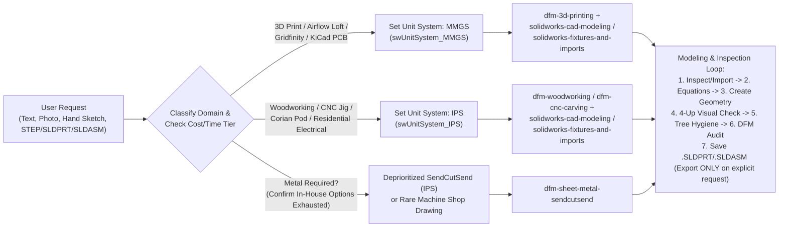

# SOLIDWORKS MCP Architecture, Workflow Routing & Tool Map

This reference document maps the end-to-end routing between user requests, Antigravity rules/skills, domain catalogs (`shop_profile.json` & `sendcutsend_catalog.json`), the **50 structured MCP tools + `sw_execute_csharp` (51 total tools)**, and the underlying SOLIDWORKS 2026 COM API.

---

## 1. Prompt-to-Unit, Skill & Tool Routing Map

> **Mandatory Export Gate**: Never call `sw_export_document`, `sw_export_scs_flat_pattern_dxf`, or PDF drawing export during modeling/DFM iterations unless the user explicitly asks to print, CAM, or order parts.

---

## 2. Complete MCP Tool Inventory (`50 Structured Tools` + `sw_execute_csharp`)

> **API Unit Rule**: The SOLIDWORKS COM API always expects lengths in **meters** and angles in **radians** regardless of the document's display unit system (`MMGS` or `IPS`). Every structured tool accepts explicit `"units": "mm" | "in" | "m"` (defaulting to the active document's unit system, or domain default `MMGS`/`IPS` on creation) and performs exact conversion internally (`1 in = 0.0254 m`, `1 mm = 0.001 m`).

### A. Session, Document & Catalog Tools (`DocumentAndSessionTools.cs`)
| Tool Name | Key Parameters | SOLIDWORKS COM APIs | Return Payload |
| :--- | :--- | :--- | :--- |
| `sw_connect_status` | `launch_if_closed`, `restart_if_running`, `force_restart`, `wait_timeout_seconds`, `minimize_cef_ui` | `Marshal.GetActiveObject("SldWorks.Application")`, Microsoft Edge UIAutomation via 3DEXPERIENCE (`eu1-ds-iam` -> **SOLIDWORKS Design**), optional `TaskPaneIsPinned=false` + `UnloadAddIn(SldAuraEx.dll)` | Active SOLIDWORKS version, open docs list, active doc path/type/units, `cef_ui_mitigation`, `launch_logs` |
| `sw_open_or_import_document` | `file_path`, `unit_override` | `OpenDoc6`, `LoadFile4`, `SetUserPreferenceIntegerValue(swUnitSystem)` | Document handle info, body count, active units, import warnings |
| `sw_create_document` | `doc_type` (`part`/`assembly`/`drawing`), `domain` (`3d_printing`/`gridfinity`/`electronics_kicad`/`woodworking`/`cnc`/`sendcutsend`), `save_path`, `template_path` | `NewDocument`, `Extension.SetUserPreferenceIntegerValue(swUnitSystem_MMGS \| swUnitSystem_IPS)` | Created doc name, enforced unit system (`MMGS` or `IPS`), template used |
| `sw_save_document` | `save_path`, `save_all_components` | `Save3`, `SaveAs3` | Saved paths, error/warning codes, and automatic `mate_health` (for assemblies) |
| `sw_export_document` | `format` (`step`/`stl`/`3mf`/`dxf`/`dwg`/`pdf`), `output_path` | `Extension.SaveAs3` (**only on explicit fabrication request**) | Exported file path(s) and warnings |
| `sw_get_shop_profile` | `section` (`all`/`hierarchy`/`printing_3d`/`gridfinity`/`electronics_and_electrical`/`airflow_and_pneumatics`/`cnc_carving`/`woodworking`/`sheet_metal_sendcutsend`/`sendcutsend_catalog`), `material`, `thickness_in` | Reads embedded `shop_profile.json` & `sendcutsend_catalog.json` | Full structured specs, bit library, insert specs, SendCutSend bend/K-factor lookup |

### B. B-Rep Topology, Datum & Clearance Inspection (`TopologyDatumExtractor.cs` & `AssemblyJointAnalyzer.cs`)
| Tool Name | Key Parameters | SOLIDWORKS COM APIs | Return Payload |
| :--- | :--- | :--- | :--- |
| `sw_inspect_model_summary` | `target_doc`, `units`, `include_mass_properties` | `IGetBodies2`, `IMassProperty2` (default on for parts, off for >30-part assemblies), `IBody2.GetBodyBox` | Body/component list, tight 3D bounding box, mass/volume/CoG, active units |
| `sw_inspect_feature_tree` | `target_doc`, `include_subfeatures` | `FirstFeature`, `GetParents`, `GetErrorCode2` (skips assembly `Reference` subfeatures for speed) | Hierarchical feature tree JSON, sketch constraint states (`(-)`/`(+)`), rebuild errors |
| `sw_inspect_topology_datums` | `target_doc`, `extract_hole_patterns`, `extract_planar_datums`, `pcb_mode`, `max_faces` | `IBody2.GetFaces`, `IFace2.Normal`, `ISurface.IsPlane`, `IsCylinder` | Ranked planar mounting faces (normals via `IFace2.Normal`, bounds, tokens), coaxial holes/bosses, bolt patterns, KiCad PCB summary |
| `sw_inspect_assembly_joints` | `nut_style` (`nylock`/`hex_nut`/`jam_nut_stack`), `material` (`18-8 Stainless Steel` default), `top_level_only`, `include_subassembly_boundary_joints`, `include_components` | Pure C# `Transform2.ArrayData` matrix math across top-level + boundary subassembly parts (CSK, CBore, BHCS clearance, hex clocking) | Grouped joint stacks, unfastened counts, head style, radial/axial clearances, McMaster SKU recipes |
| `sw_measure_clearance` | `include_components` (required for assembly interference, 2–40 components), `ignore_pairs`, `group_by_pair`, `exclude_expected_thread_engagements`, OR `entity_a` + `entity_b` | Subset pre-selected `IInterferenceDetectionMgr` (unfiltered all-to-all disabled) + `InterferenceHoleCache`, or `ClosestDistance` | Grouped `unexpected_collision` vs `expected_thread_engagement` counts/volumes, ignored counts, or min distance |

### C. Multimodal Viewport Vision & Sketch Pictures (`ViewportVisionTools.cs`)
| Tool Name | Key Parameters | SOLIDWORKS COM APIs | Return Payload |
| :--- | :--- | :--- | :--- |
| `sw_capture_viewport_quad` | `target_doc`, `views` (default `["*Isometric","*Top","*Front","*Right"]`), `highlight_tokens`, `panel_width_px`, `panel_height_px`, `save_png_path` | `ShowNamedView2`, `ViewZoomtofit2`, `SaveBMP`, `System.Drawing` composite annotator | Annotated 4-up composite PNG returned as MCP `image` content + saved PNG path + bounding dimensions |
| `sw_insert_sketch_picture` | `plane_or_face`, `image_path`, `point1_px`, `point2_px`, `real_distance`, `units`, `transparency` | `ISketchManager.InsertSketchPicture`, `SetSize`, `SetOrigin`, `SetTransparency` | Calibrated picture dimensions and active plane |

### D. Sketching, Equations & Reference Geometry (`SketchAndEquationTools.cs`)
| Tool Name | Key Parameters | SOLIDWORKS COM APIs | Return Payload |
| :--- | :--- | :--- | :--- |
| `sw_manage_equations` | `action` (`get`/`set`/`link_file`/`sync`), `equations_txt_path`, `variables` | `IModelDoc2.GetEquationMgr`, `IEquationMgr.Add3`, `FilePath`, `LinkToFile`, `EvaluateAll` | Active equations, evaluated values, linked external `equations.txt` path |
| `sw_create_2d_sketch` | `plane_or_face`, `sketch_name`, `entities`, `units`, `model_space_coords`, `close_sketch` | `InsertSketch`, `AddToDB`, `ModelToSketchTransform`, `IMathUtility` | Created sketch name, solve status, entity count |
| `sw_create_3d_guide_sketch` | `sketch_name`, `curves` (3D spline/line points), `units` | `Insert3DSketch`, `CreateSpline2`, `CreateLine`, `AddToDB` | 3D sketch name and curve count |
| `sw_create_reference_geometry` | `kind` (`plane`/`axis`/`coord_sys`), `references`, `offset`, `angle_deg`, `flip`, `name` | `InsertRefPlane`, `InsertAxis2`, `CreateCoordinateSystemUsingNumericalValues` | Created reference feature name |

### E. 3D Modeling, Airflow Lofts, Gridfinity, Presets & Fixtures (`FeatureAndFixtureTools.cs`)
| Tool Name | Key Parameters | SOLIDWORKS COM APIs | Return Payload |
| :--- | :--- | :--- | :--- |
| `sw_extrude_boss_or_cut` | `sketch_name`, `mode` (`boss`/`cut`), `depth`, `start_offset`, `start_offset_mode` (`model_positive`/`sketch_normal`), `mid_plane`, `through_all`, `flip_direction`, `draft_deg`, `merge`, `feature_name`, `units` | `FeatureExtrusion3`, `FeatureCut4` (`swStartOffset` + automatic single-direction flip fallback) | Created feature name, offset info |
| `sw_revolve_boss_or_cut` | `sketch_name`, `mode`, `angle_deg`, `merge`, `feature_name` | `FeatureRevolve2` | Created feature name |
| `sw_create_airflow_loft_or_sweep` | `mode` (`loft`/`sweep`), `profiles`, `path_sketch`, `circular_diameter`, `guide_curves`, `start_tangent_normal`, `wall_thickness_mm`, `merge`, `units`, `feature_name` | `InsertProtrusionBlend2`, `InsertProtrusionSwept4` (`CircularProfile` support + pre-sweep curvature/kink validation $R > D/2$) | Feature name, `min_path_bend_radius`, `min_bend_location`, thin-wall perimeters |
| `sw_shell_duct_or_body` | `thickness`, `outward`, `open_face_tokens`, `units` | `InsertFeatureShell` | Shelled thickness, open ports confirmed |
| `sw_fillet_or_chamfer` | `kind` (`fillet`/`chamfer`), `edge_or_face_tokens`, `size`, `angle_deg`, `units`, `feature_name` | `FeatureFillet3`, `InsertFeatureChamfer` | Feature name |
| `sw_pattern_or_mirror` | `kind` (`linear`/`circular`/`mirror`), `feature_names`, `direction_ref`, `spacing`, `count`, `flip`, `units` | `FeatureLinearPattern4`, `FeatureCircularPattern4`, `InsertMirrorFeature2` | Pattern feature name & count |
| `sw_hole_preset` | `preset_type` (`mcmaster_insert` / `forstner_metric` / `qcw_dowel_grid` / `domino_mortise` / `blum_hinge_cup` / `npt_1_8_vac_tap` / `fastener_thru`), `preset_id`, `face_token`, `locations`, `depth`, `units` | Sketch + `FeatureCut4` preset pockets | Created feature name, hole count, McMaster PN recommendation |
| `sw_create_gridfinity` | `kind` (`bin`/`baseplate`), `units_x`, `units_y`, `height_u`, `include_stacking_lip`, `magnet_pockets`, `m3_screw_holes`, `wall_thickness_mm`, `floor_thickness_mm`, `hollow_interior`, `embossed_label` | Parametric `MMGS` sketch + base chamfer extrude/cut stack | Outer dimensions (`mm`), Prusa MK3.5S+ fit check |
| `sw_boolean_or_fixture_cavity` | `operation` (`subtract`/`indent`/`common`), `target_body`, `tool_step_or_part_path`, `tool_body_name`, `clearance_offset`, `wall_thickness`, `units` | `InsertPart2`, `InsertCombineFeature`, `InsertIndent` | Feature name, applied clearance |
| `sw_create_bending_form` | `target_curved_face_token`, `veneer_ply_count`, `ply_thickness`, `breather_allowance`, `caul_thickness`, `units` | `InsertOffsetSurface` + `FeatureBossThicken` | Offset & caul thickness confirmation |
| `sw_engrave_or_emboss_label` | `face_token`, `text`, `origin_xyz`, `font_height`, `depth`, `material_context`, `emboss`, `units` | `InsertSketchText`, `FeatureCut4` / `FeatureExtrusion3` | Recommended CNC V-bit or print emboss |
| `sw_invoke_repo_addin_tool` | `tool` (`export_faces_dxf`/`3dprint_teardrop`/`3dprint_bridge`/`joinery`), `output_folder`, `mode`, `overcut` | Runs `ExportFacesToDXF.swp` via `RunMacro2(..., 2)` | Execution status / paths |

### F. McMaster-Carr Add-In BOM, Hardware Stacking & Drawings (`DrawingAndMcMasterTools.cs` & `FastenerStackInstaller.cs`)
| Tool Name | Key Parameters | SOLIDWORKS COM APIs | Return Payload |
| :--- | :--- | :--- | :--- |
| `sw_search_and_download_mcmaster` | `mcmaster_pn`, `mcmaster_pns`, `specs`, `expected_length_mm`, `query`, `material`, `nut_style`, `library_dir`, `download_if_missing`, `prepare_fastener_axis` | Local cache + in-process `SolidWorks3DPrintDFMAddin.InvokeMcMasterBridge` WebView automation + `EnsureFastenerAxisAndInspect` | Verified `.SLDPRT` path(s), canonical B-Rep `FastenerPartProfile`, length/kind self-check |
| `sw_install_fastener_stack` | `stacks` (`hole_component`, `holes`, `axis`, `head_face_*`, `nut_face_*`, `bolt_pn`, `head_washer_pn`, `nut_washer_pn`, `nut_pn`, `jam_nut_pn`), `library_dir`, `folder_name` | Pre-opens hardware silently, inserts, unfixes, mates `Concentric` (`"Fastener_Axis"`) + `Coincident` via `AddMate5`, groups via `ReorderComponents`, single `EditRebuild3()` | SKU counts, `mates_succeeded`, `fixed_count`, `assembly_mate_errors`, automatic `mate_health` |
| `sw_populate_mcmaster_hardware` | `mcmaster_pn`, `description`, `part_path`, `placements`, `hole_face_or_edge_tokens`, `create_mates`, `allow_placeholder_generation` (`false`) | Inserts genuine `.SLDPRT`, applies pose, mates (`Fastener_Axis` + bearing face) with cached candidate scan, groups in `"McMaster Hardware"` | Inserted names, mate results, BOM regex match, automatic `mate_health` |
| `sw_extract_mcmaster_and_shop_bom` | `target_doc`, `units` | Traverses components/bodies & McMaster part numbers | Unified hardware + part BOM |
| `sw_create_exploded_assembly_view` | `steps` (`component_name`/`component_names`, `distance`, `direction_index`, `reverse`), `show_exploded`, `auto_explode` (`false` default, guarded `<= 20` comps) | `CreateExplodedView`, `IConfiguration.AddExplodeStep2`, `ShowExploded` | Exploded view status & step count |
| `sw_create_fabrication_drawing` | `source_model_path`, `mode`, `sheet_size`, `include_exploded_view`, `include_flat_pattern`, `save_drw_path`, `export_pdf_path` | `NewDrawing2`, `Create3rdAngleViews2`, `AutoBalloon5`, `InsertBomTable4` | Created `.SLDDRW` / `.PDF` (only export when requested) |
| `sw_add_drawing_callouts_and_bom` | `shop_notes`, `target_doc` | `InsertNote`, `SetPosition` | Notes added |

### G. SendCutSend Sheet Metal Tools (`SheetMetalSendCutSendTools.cs`)
| Tool Name | Key Parameters | SOLIDWORKS COM APIs | Return Payload |
| :--- | :--- | :--- | :--- |
| `sw_create_scs_sheet_metal_base` | `material`, `thickness_in`, `sketch_name`, `confirm_vendor_cost` | `InsertSheetMetalBaseFlange2` with `sendcutsend_catalog.json` exact K-factor & bend radius | Created Base-Flange & bend note |
| `sw_add_scs_edge_flange` | `edge_tokens`, `length_in`, `angle_deg`, `material`, `thickness_in`, `flip` | `InsertSheetMetalEdgeFlange2` | Created Edge-Flange |
| `sw_add_scs_tab_and_slot` | `face_token`, `center_xyz_in`, `tab_width_in`, `mating_thickness_in`, `slot_clearance_in` (`0.010`) | Parametric clearance slot cut | Slot dimensions & relief reminder |
| `sw_export_scs_flat_pattern_dxf` | `output_dxf_path`, `include_bend_lines` | `IPartDoc.ExportToDWG2` (**only on explicit order request**) | Clean 1:1 DXF path & checklist |

### H. Feature Tree Hygiene, Component Management & Multibody Splitting (`FeatureTreeAndAssemblyTools.cs`)
| Tool Name | Key Parameters | SOLIDWORKS COM APIs | Return Payload |
| :--- | :--- | :--- | :--- |
| `sw_organize_feature_tree` | `rename_semantically`, `reorder_dag`, `group_folders`, `verify_mass_equivalence` | `IFeature.Name`, `GetChildren`, `ReorderFeature2`, `EditRebuild3`, `ComputeMassStats` | Rename map, reorder log, `0.00%` drift check |
| `sw_refactor_to_shared_equations` | `equations_txt_path`, `include_wood_ply_defaults`, `include_3dp_defaults` | Writes `equations.txt` & links `IEquationMgr` | Linked `equations.txt` & added globals |
| `sw_split_multibody_to_assembly` | `output_dir`, `assembly_name`, `dependency_strategy` (`master_derived` \| `independent_shared_equations_mated`) | `InsertPart2`, `InsertDeleteBody2`, `AddComponent5`, `FixComponent` | Split parts & assembly paths |
| `sw_manage_assembly_components` | `action` (`insert`/`replace`/`delete`/`delete_mates`/`transform`/`mate`/`fix`/`float`/`move_to_folder`/`batch`/`swap_fastener_and_insert_spacer`), `component_names`, `mate_names`, `mate_type_filter`, `operations`, `swap_spec` | Modal-guarded `EnableFeatureTree=false` component/mate edits (`DeleteSelection2`, `ReorderComponents`, `ReplaceComponents2`) with single `EditRebuild3()` | Per-action or atomic batch/swap summary + automatic `mate_health` |
| `sw_audit_assembly_mates` | `include_subassemblies` (`true`), `include_feature_errors` (`true`), `include_suppressed` (`false`), `rebuild_first` (`false`), `target_doc` | Folder-safe `MateGroup`/`FtrFolder` traversal + `IFeature.GetErrorCode2` + `IMateEntity2` dangling check + `IModelDocExtension.GetWhatsWrong` | `clean` (`PASS`/`FAIL`), `red_mate_count`, `yellow_mate_count`, `bad_mates` (with dangling entities & suggested fixes), `bad_mate_names`, `affected_components`, `other_feature_issues` |

### I. Automated DFM Auditor & Shop Cutlists (`DfmAuditAndFabricationTools.cs`)
| Tool Name | Key Parameters | SOLIDWORKS COM APIs | Return Payload |
| :--- | :--- | :--- | :--- |
| `sw_audit_dfm` | `process` (`3d_printing`/`cnc_carving`/`sheet_metal_sendcutsend`/`woodworking`), `build_direction`, `min_web_thickness_mm` (`1.2`), `material`, `thickness_in` | B-Rep scan + `RayIntersections` thin-web audit (overhangs `>45°`, bed chamfers vs fillets, `<1.2mm` webs), CNC 8-bit `R>=0.135"`, woodworking widths, SCS catalog | Pass/Warn/Fail findings with coordinates & face tokens |
| `sw_generate_cutlist_and_templates` | `kerf_in` (`0.125`/`0.094`), `router_bushing_od_in`, `router_bit_dia_in`, `output_dir` | Oriented body boxes & kerf/offset math | Cut list & clamp-stage plan |

### J. Universal Roslyn Transactional C# API Runner (`DynamicCSharpTool.cs` & `SwHelper.cs`)
| Tool Name | Key Parameters | SOLIDWORKS COM APIs | Return Payload |
| :--- | :--- | :--- | :--- |
| `sw_execute_csharp` | `code_body`, `undo_name`, `rollback_on_error`, `use_undo_transaction`, `additional_usings`, `compile_only`, `allow_disconnected` | Roslyn `csc.exe -langversion:latest` (`out bool`, tuples, local funcs, `new()`) + built-in **`SwHelper.*`** (`Activate`, `SuppressUiUpdates`, `BatchDeleteComponents`, `BatchDeleteMates`, `BatchDeleteMatesForComponents`, `GetVisibleSketchNames`, `HideSketches`, `MinimizeCefUiNoise`, `MakeOffsetPlane`, `FindPlanarFace`, `FindCylindricalFace`, `MoveComponentsToFolder`, `MateByPrincipalPlanes`) + static guard against `swUserDecision`/`.EditDelete()`/`CommandInProgress` + modal guard | Execution result + `logs` (preserved even when runtime exceptions occur) |

### K. Assembly Transforms, Cable Routing & Motion Stroke Verification (`KinematicsAndRoutingTools.cs`)
| Tool Name | Key Parameters | SOLIDWORKS COM APIs | Return Payload |
| :--- | :--- | :--- | :--- |
| `sw_query_assembly_transforms` | `component_paths` (incl. nested slash paths), `points`, `vectors`, `from_frame`, `to_frame`, `units` | `ResolveComponentByPath` + pure C# `Transform2.ArrayData` 4x4 & inverse transforms + world AABB & mate count | Local-to-world / world-to-local 4x4 matrices, world boxes, converted points/vectors |
| `sw_route_cable_or_loom` | `target_component`, `create_part_path`, `waypoints`, `u_loop_spec` (`plane_axis`, `bend_radius`, ...), `outer_diameter_mm`, `wall_thickness_mm`, `min_bend_radius_mm`, `clearance_check_components` | World-to-local waypoint projection, `3DSketch` (`CreateSpline2` / `CreateLine` + `Create3PointArc`), curvature validation ($R > D/2$), `InsertProtrusionSwept4` (`CircularProfile`), subset interference & `ClosestDistance` | Created path/sweep feature, path length, min bend radius, neighbor distances & collisions |
| `sw_verify_motion_stroke` | `moving_component`, `drive_mode` (`distance`/`angle`), `drive_entity_a`/`b` or `existing_drive_mate`, `suppress_mates`, `suppress_components`, `stops`, `rail_checks`, `limit_switch_checks`, `clearance_check_components`, `ignore_pairs` | Suppresses limits/U-loops, drives stops via `IDimension.SetSystemValue3` + `EditRebuild3()`, checks rail bearing overrun & limit switch clearances + subset `IInterferenceDetectionMgr`, restores resting pose in `finally` | Per-stop box, rail margins, switch gap/compression, collisions, `restored_cleanly`, `resting_pose_drift_mm`, automatic `mate_health` |

---

## 3. SOLIDWORKS Feature-to-COM-API Reference Map

| Feature Family | Primary SOLIDWORKS COM Interfaces & Methods | Critical Implementation Rules |
| :--- | :--- | :--- |
| **Document & Units** | `ISldWorks.NewDocument`, `OpenDoc6`, `LoadFile4`, `ActivateDoc3(..., swDontRebuildActiveDoc, ...)` | Never pass `swUserDecision`; enforce `MMGS` or `IPS`; pass COM lengths in **meters** and angles in **radians**. |
| **2D & 3D Sketching** | `ISketchManager.InsertSketch`, `Insert3DSketch`, `AddToDB`, `CreateLine`, `Create3PointArc`, `CreateSpline2` | Project 3D model coordinates via `activeSketch.ModelToSketchTransform`; wrap geometry creation in `AddToDB = true/false`. |
| **Extrude / Revolve** | `IFeatureManager.FeatureExtrusion3`, `FeatureCut4`, `FeatureRevolve2` | In `FeatureCut4`, keep `Flip = false` (`true` cuts outside); use `swStartOffset` or `swEndCondMidPlane` on centered offset planes. |
| **Lofts, Sweeps & Shells** | `IFeatureManager.InsertProtrusionBlend2`, `InsertProtrusionSwept4(..., CircularProfile, ...)`, `InsertFeatureShell` | Pre-validate sweep curvature ($R > D/2$); select open faces before `InsertFeatureShell`. |
| **Fillets, Chamfers & Patterns** | `FeatureFillet3`, `InsertFeatureChamfer`, `FeatureLinearPattern4`, `FeatureCircularPattern4`, `InsertMirrorFeature2` | Place cosmetic fillets/chamfers late in the tree; avoid rounded fillets on 3D-print bed edges. |
| **Hole Wizard & Fasteners** | `sw_hole_preset`, `McMaster.SolidWorks.CustomerAddIn.dll` | Match `^\d{4,5}[a|k|n|t]\d{1,3}_`; create `"Fastener_Axis"`; mate `Concentric` + `Coincident` (`swAddMateError_NoError == 1`). |
| **Assemblies, Mates & Kinematics** | `AddComponent5`, `AddMate5`, `IAssemblyDoc.ReorderComponents`, `IInterferenceDetectionMgr`, `IDimension.SetSystemValue3` | Read normals from `IFace2.Normal`, matrices from `Transform2.ArrayData`, solve mates with `EditRebuild3()`, delete via `DeleteSelection2(0)`, and always scope `IInterferenceDetectionMgr` by selection. |
| **3D Print / B-Rep DFM** | `IModelDoc2.RayIntersections`, `IFace2.Normal`, `ISurface.Evaluate` | Detect `>45°` overhangs, rounded bed fillets vs chamfers, and `<1.2 mm` thin webs. |
